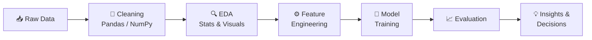
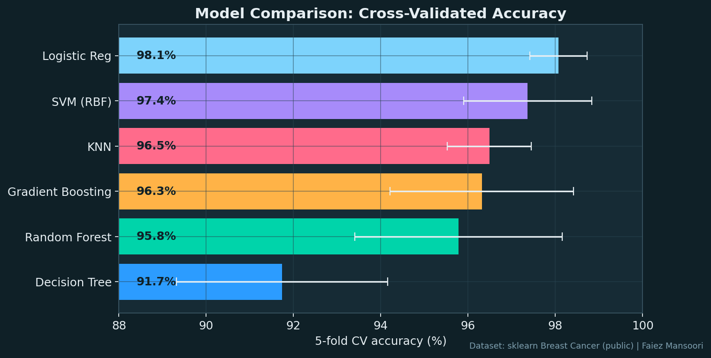
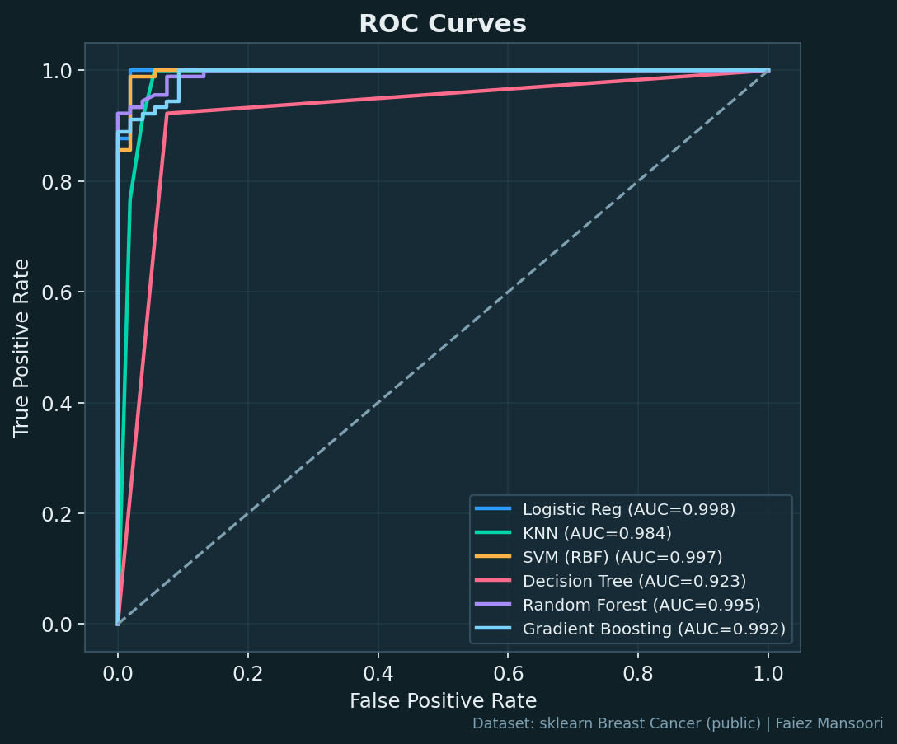
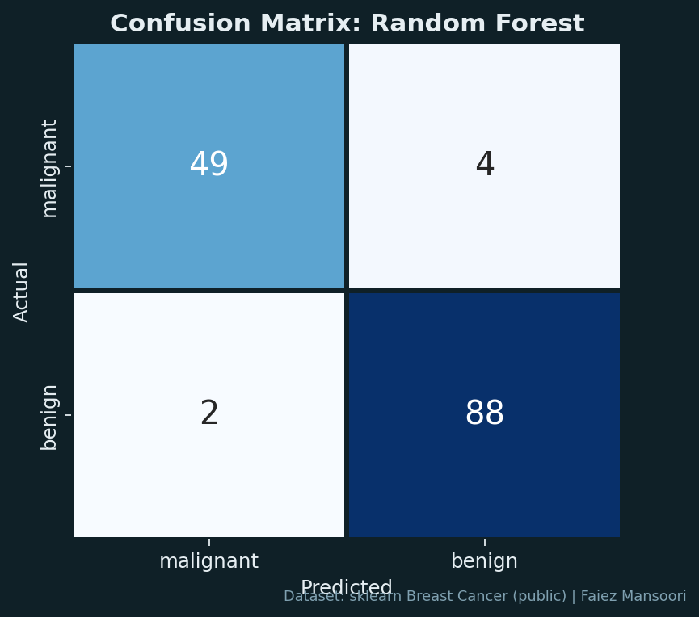
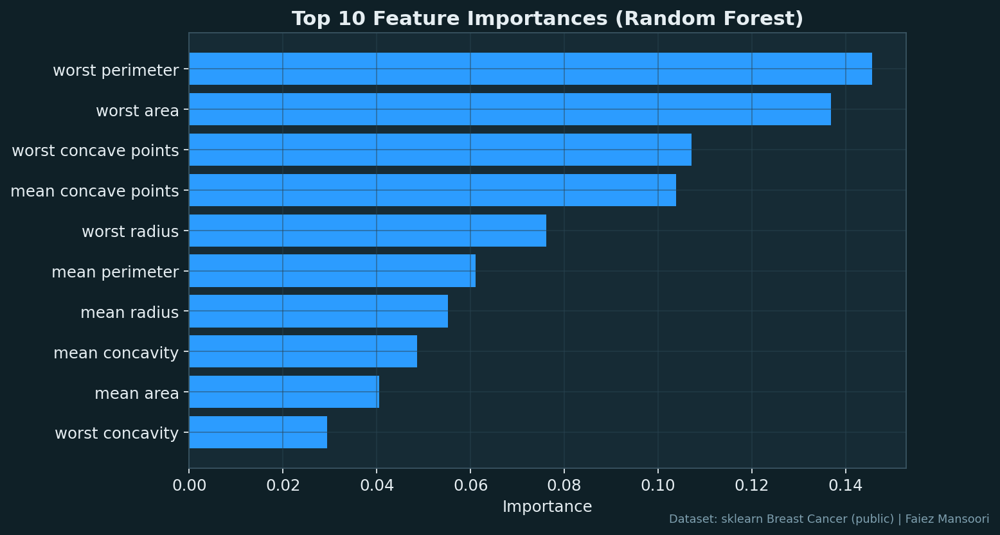
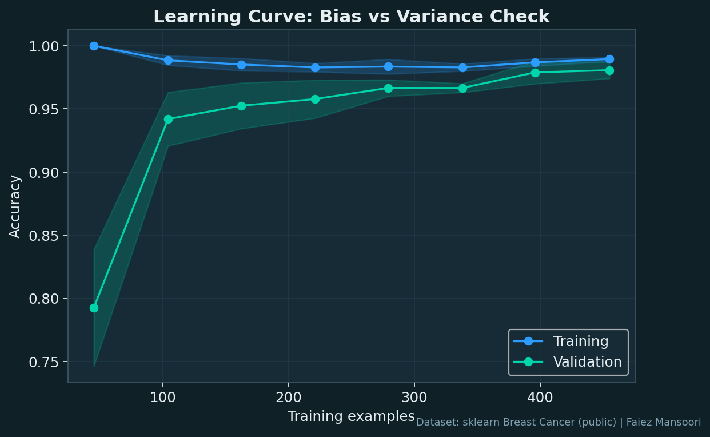
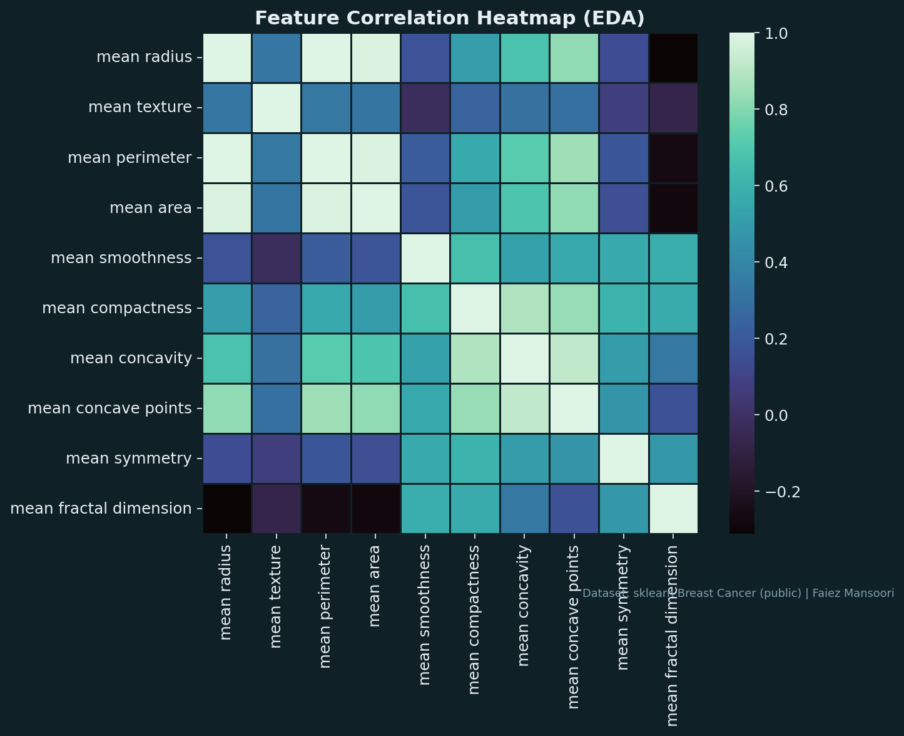
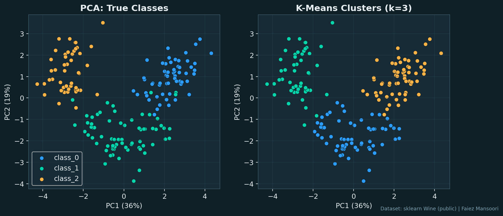
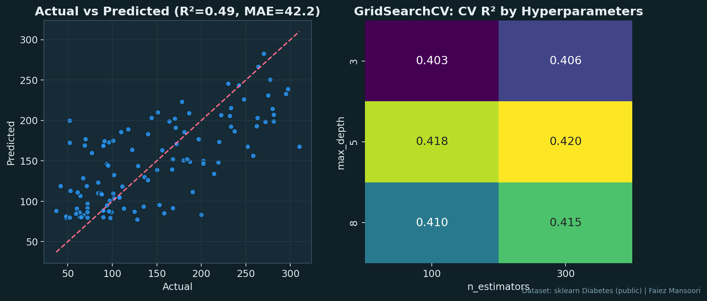

<h3 align="center">🤖 Machine Learning Experiments &amp; Data Science Portfolio</h3>

  

  
  

  
  
  

---

## 💫 About Me

B.Tech student in **Artificial Intelligence & Data Science** (LNCT Group of Colleges, 2024) based in **Bhopal, Madhya Pradesh**. I turn raw data into **insights, models and practical solutions** using **Python, SQL and Machine Learning**. I learn best by building, so I focus on hands-on projects and continuous learning.

> [!TIP]
> 🎯 **Open to:** AI/ML, Data Science and Data Analyst internships
> 📫 **Reach me at:** [engineerfaiezmansoori@gmail.com](mailto:engineerfaiezmansoori@gmail.com)

- 🎓 **Education:** B.Tech, Computer Software Engineering, LNCT Group of Colleges (2024)
- 🤖 **Focus:** Machine Learning, Data Analytics, Statistics
- 📊 **Core skills:** Python, SQL, Pandas, NumPy
- 💡 **Strengths:** Data Structures, Problem Solving, File Handling
- 🌱 **Currently learning:** Model tuning, evaluation and end-to-end ML projects

---

## 🧠 How I Approach a Data Problem

---

## 🛠️ Technical Skills

| Area | Tools |
|------|-------|
| **Programming** | Python, SQL (MySQL) |
| **Data Analysis** | Pandas, NumPy, Statistics |
| **Machine Learning** | scikit-learn, Model Evaluation, Hyperparameter Tuning, PCA, Clustering |
| **Visualization** | Matplotlib, Seaborn |
| **CS Fundamentals** | Data Structures, Problem Solving, File Handling |

---

## 💻 Tech Stack

  
  
  
  
  
  
  
  
  

---

## 🏆 ML Experiments

> Practice experiments on public scikit-learn datasets (Breast Cancer, Wine, Diabetes).

| Experiment | Dataset | Techniques | Result |
|------------|---------|------------|--------|
| 🔬 **Model Comparison** | Breast Cancer | 6 classifiers, 5-fold cross-validation | Logistic Regression best at **98.1%** CV accuracy |
| 📈 **ROC & Confusion Matrix** | Breast Cancer | ROC-AUC, Random Forest | Evaluation beyond plain accuracy |
| 🧬 **Clustering & PCA** | Wine | PCA, K-Means (k=3) | Unsupervised clusters vs true classes |
| ⚙️ **Hyperparameter Tuning** | Diabetes | Random Forest Regressor, GridSearchCV | Best: `max_depth=5`, `n_estimators=300` |

---

## 📈 ML Showcase

  
  

  
  

  
  

  

  

---

## 🗺️ Learning Roadmap

- [x] Python, SQL, Pandas, NumPy
- [x] Statistics & Data Analytics fundamentals
- [x] Model comparison, cross-validation and evaluation (ROC, confusion matrix)
- [x] PCA, K-Means and hyperparameter tuning
- [ ] Feature engineering on real-world datasets
- [ ] Deep Learning basics (neural networks)
- [ ] Deploying an ML model (Streamlit / Flask)
- [ ] Full end-to-end AI/ML project

---

## 📊 GitHub Stats

  
  

  

---

  

